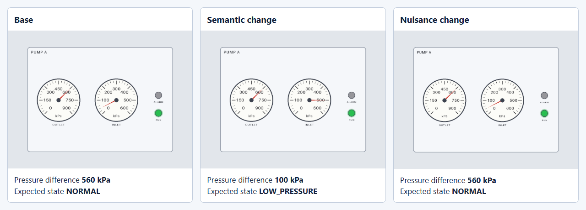
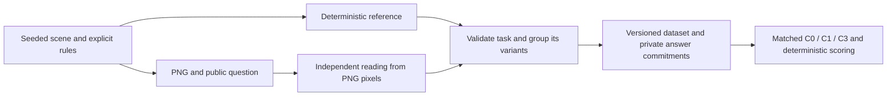
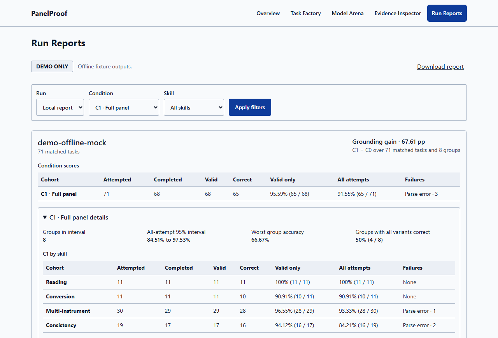

# PanelProof

**A visual benchmark for reading gauges, associating instruments with the right pump, and applying explicit rules.**

Built for the Innodata Frontier AI Hackathon, Track 2 · Visual Task Factory. PanelProof generates fictional water-pump panels, questions, and deterministic answers. A separate PNG verifier checks what is visible before accepted tasks enter the benchmark. An independent Rust implementation checks the rules, and a local judge console shows how scoring and evidence reveal work. [Official Track 2 brief](https://hack2skill.com/event/innodata/?sectionid=6aee108b9be15aea67016065)

[Try it locally](#quickstart) · [See a benchmark task](#one-question-three-panels) · [Review the evidence](#evidence-and-status) · [Submission checklist](submission/DELIVERABLE.md)


## One question, three panels

**What operating state follows from the readings and RUN indicator for PUMP A?** With RUN on, subtract inlet pressure from outlet pressure. A difference of at least 300 kPa yields NORMAL. A smaller difference yields LOW_PRESSURE.



| Example | What changes | Expected state |
| --- | --- | --- |
| Base | INLET 40 kPa, OUTLET 600 kPa, RUN on | NORMAL |
| Semantic | INLET moves to 500 kPa while OUTLET and RUN stay fixed | LOW_PRESSURE |
| Nuisance | Text size changes while the readings and RUN stay fixed | NORMAL |

The same question applies to all three panels. A reader who follows the evidence should change the answer for the semantic pair and preserve it for the nuisance pair. In an equipment inspection, assigning a gauge to the wrong pump or overlooking a unit can change which operating state a reader reports. These are fictional scenarios. [Task card](docs/task_card.md) · [Demo script and example IDs](submission/demo_script.md#arena-sample-and-inspector)

## Quickstart

Use a Git checkout for the exact examples above. The local demo runs on CPU and uses fixture model attempts.

```sh
git clone https://github.com/Pradhyut21/Proof-pay.git
cd Proof-pay
```

### Start the judge console

Install stable Rust, Python 3.11 with [uv](https://docs.astral.sh/uv/), Node.js 22+, and pnpm. On native Windows, make the Rust MSVC toolchain and C++ build tools available.

| Step | Linux, macOS, or WSL | Windows PowerShell |
| --- | --- | --- |
| Install project dependencies | `./run.sh bootstrap` | `.\run.ps1 bootstrap` |
| Start the API in terminal 1 | `mkdir -p data/runs`, then `./run.sh api` | `.\run.ps1 api` |
| Start the web app in terminal 2 | `export PP_PYTHON="$PWD/python/.venv/bin/python"`, then `./run.sh web` | `$env:PP_PYTHON = (Resolve-Path 'python/.venv/Scripts/python.exe').Path`, then `.\run.ps1 web` |

Open [http://127.0.0.1:3000](http://127.0.0.1:3000).

| View | Try this |
| --- | --- |
| **Task Factory** | Generate two panels with seed `judge-rehearsal`, then submit an answer to see deterministic scoring. |
| **Model Arena** | Compare panels using semantic pair `p_784449ff7096f562` and nuisance pair `p_114a1f1fc1ae6b9c`. |
| **Evidence Inspector** | Select the base task `t_4ca4005a1f640860` and click **Reveal evidence** to see the reference and recovered readings. Fresh Factory results also show generator readings and independently located gauge regions. |
| **Run Reports** | Generate a local aggregate with `./run.sh reproduce` or `.\run.ps1 reproduce`. Open **Run Reports** to filter and export it. The browser labels fixture results **DEMO ONLY**. |

For a Compose preview, run `docker compose up --build`. Compose serves the checked-in Arena and Inspector examples. Use the native steps above for new Factory generation. For an extracted source ZIP, generate the demo bundle before either launch path. [Source ZIP setup and test commands](docs/reproducibility.md#start-from-an-extracted-source-zip)

## How the benchmark works



- **Skills** include gauge reading (R), unit conversion (C), multi-instrument reasoning (M), and indicator consistency (X). The dataset includes semantic, nuisance, and answer-preserving pairs plus a separate missing-evidence diagnostic set.
- **Verification** recovers readings from the rendered PNG. The generator’s scene truth is used in the later comparison step. Ambiguous or unsupported candidates are rejected. Python and Rust independently implement the rules using the same fixed-point unit factors.
- **Evaluation** compares the same tasks under C0 (text), C1 (text and image), and C3 (text and verified visible readings). Exported metrics include both accuracy denominators, grouped intervals, errors, and pair behavior. The measured-report gate checks the frozen selection, model revision, and actual input commitments. [Evaluation conditions](evals/conditions.md) · [Runner](evals/runner.md)

## Evidence and status

| Track 2 criterion | PanelProof evidence |
| --- | --- |
| Implementation and repeatability · 25% | Seeded generator, grouped export, CLI smoke, dataset audit, and local judge console. Windows browser checks and Linux CI passed. Compose build/startup and macOS core tests passed. [Reproduction guide](docs/reproducibility.md) |
| Validity · 25% | Independent raster recovery on **19 of 20** clean scenes, with exact agreement on all 19 recoveries. Independent Python/Rust rules agreed on **1,000** seeded scenes. Human review is pending. [Validation](docs/validation.md) |
| Meaningful variation · 20% | The v0.4 holdout contains **1,002** answerable tasks across three layouts and two operating-state rules, including **300** inlet-floor tasks and **437** valid pairs. Measured runs default to the balanced X scope. [Dataset card](docs/dataset_card.md) |
| Originality and engineering judgment · 15% | Visible readings, independent checks, matched input conditions, and pair-preserving shortcut controls. A 50-task development cohort passed C0/C1/C3 preflight. Live-model findings are pending. [Evaluation status](docs/evaluation_results.md) · [Prior-work audit](docs/source_audit.md) |
| Practical impact and communication · 15% | Generate, answer, compare, and reveal evidence in the browser. The walkthrough shows a rule-threshold error and a formatting-only change. The automated browser rehearsal passed. The timed presentation is pending. [Demo walkthrough](submission/demo_script.md) |

The production verifier is scoped to clean synthetic renders. A performance gap between development and frozen splits remains unmeasured. Human review is **0 of 50**, and live model results are pending. The screenshot below shows an offline report labeled **DEMO ONLY**. [Evaluation status and limits](docs/evaluation_results.md)

Dataset manifests pin encoded PNG bytes. Match the generation environment for an exact rebuild. When PNG hashes differ across environments, compare the decoded pixels separately. [Artifact hashes and decoded pixels](docs/reproducibility.md#artifact-hashes-and-decoded-pixels)



## Documentation

| I want to… | Start here |
| --- | --- |
| Understand the goal and system | [PRD](PRD.md) · [Architecture](docs/architecture.md) · [Shared contract](reference/CONTRACT.md) |
| Run, test, or package the project | [Reproduction guide](docs/reproducibility.md) · [API reference](docs/api.md) · [Submission checklist](submission/DELIVERABLE.md) |
| Inspect tasks and validation | [Task card](docs/task_card.md) · [Dataset card](docs/dataset_card.md) · [Validation](docs/validation.md) · [Human audit](docs/human_audit.md) |
| Run or review the model evaluation | [Evaluation status](docs/evaluation_results.md) · [Protocol](evals/protocol.md) · [Runner](evals/runner.md) · [Metric definitions](evals/conditions.md) |
| Prepare a judge review | [Official requirements](reference/SUBMISSION.md) · [Demo script](submission/demo_script.md) · [Source review](docs/judge_audit.md) |

Code is available under the [MIT license](LICENSE). Terms for a separate generated dataset release are pending a team decision. [Dataset sources](docs/dataset_sources.md) · [Third-party notices](THIRD_PARTY_NOTICES.md)
