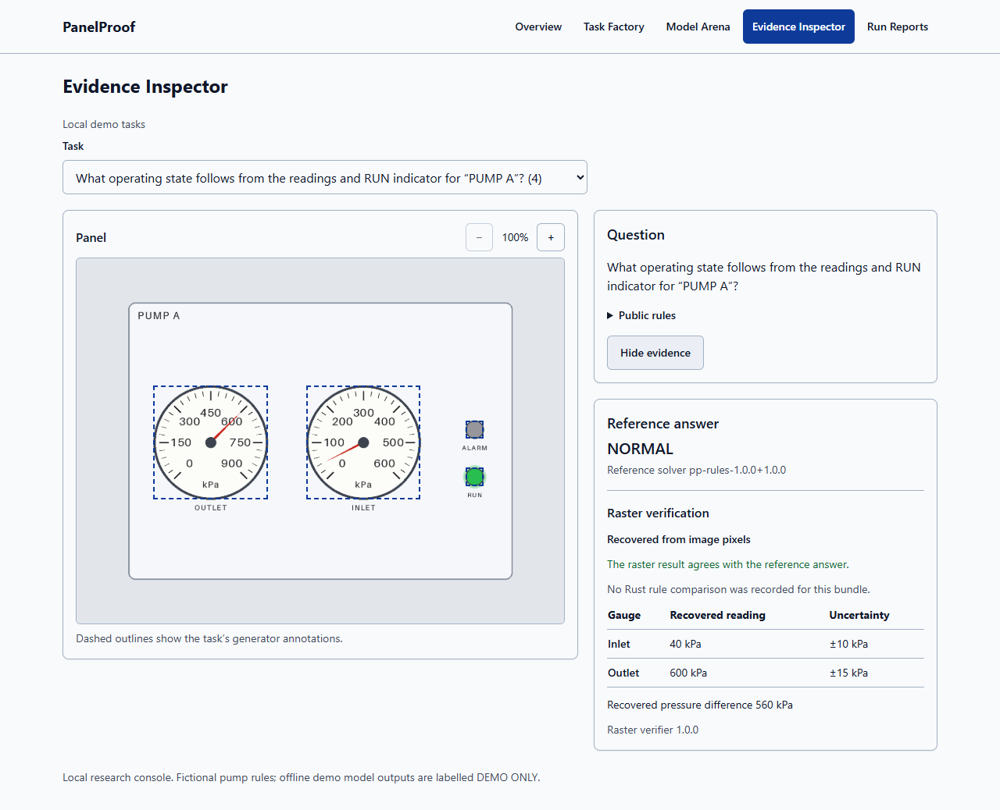
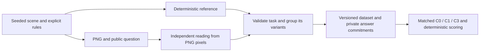

# PanelProof

**A visual benchmark for reading gauges, matching instruments to the correct pump, and applying operating rules.**

Team **TXET** · KM Pradhyut and Sai Kishan · Innodata AI Hackathon, Track 2 · Visual Task Factory.

PanelProof generates fictional water-pump panels with deterministic answers. An independent PNG verifier recovers the visible readings, and a Rust solver cross-checks the rule outcome. The local console lets judges generate a task, score an answer, and inspect its evidence.

[Run the demo](#quickstart) · [Try a benchmark question](#one-question-three-panels) · [Review validation](#evidence-and-status) · [Submission deck](https://github.com/Pradhyut21/Panel_Proof/blob/main/submission/PanelProof_Innodata_Idea_Submission.pdf) · [Submission handoff](submission/DELIVERABLE.md)

**Evidence status** · Local scoring, reproducibility, and automated validation are available. Live model results and human answerability review are pending. The console labels offline fixture reports **DEMO ONLY**.



## One question, three panels

**What operating state follows from the readings and RUN indicator for PUMP A?** With RUN on, subtract inlet pressure from outlet pressure. A difference of at least 300 kPa yields NORMAL. A smaller difference yields LOW_PRESSURE.


| Example | What changes | Expected state |
| --- | --- | --- |
| Base | INLET 40 kPa, OUTLET 600 kPa, RUN on | NORMAL |
| Semantic | INLET moves to 500 kPa while OUTLET and RUN stay fixed | LOW_PRESSURE |
| Nuisance | Text size changes while the readings and RUN stay fixed | NORMAL |

The same question applies to all three panels. A reader who follows the evidence should change the answer for the semantic pair and preserve it for the nuisance pair. In an equipment inspection, assigning a gauge to the wrong pump or overlooking a unit can change which operating state a reader reports. These are fictional scenarios. [Task card](docs/task_card.md) · [Demo script and example IDs](submission/demo_script.md#arena-sample-and-inspector)

## Quickstart

Use a Git checkout for the exact examples above. The local demo runs on CPU and uses fixture model attempts.

```sh
git clone https://github.com/Pradhyut21/Panel_Proof.git
cd Panel_Proof
```

### Start the judge console

Install stable Rust, Python 3.11 with [uv](https://docs.astral.sh/uv/), Node.js 22+, and pnpm. On native Windows, make the Rust MSVC toolchain and C++ build tools available.

| Step | Linux, macOS, or WSL | Windows PowerShell |
| --- | --- | --- |
| Install project dependencies | `./run.sh bootstrap` | `.\run.ps1 bootstrap` |
| Start the API in terminal 1 | `mkdir -p data/runs`, then `./run.sh api` | `.\run.ps1 api` |
| Start the web app in terminal 2 | `export PP_PYTHON="$PWD/python/.venv/bin/python"`, then `./run.sh web` | `$env:PP_PYTHON = (Resolve-Path 'python/.venv/Scripts/python.exe').Path`, then `.\run.ps1 web` |

Open [http://127.0.0.1:3000](http://127.0.0.1:3000).

| View | Try this |
| --- | --- |
| **Task Factory** | Generate two panels with seed `judge-rehearsal`, then submit an answer to see deterministic scoring. |
| **Model Arena** | Compare panels using semantic pair `p_784449ff7096f562` and nuisance pair `p_114a1f1fc1ae6b9c`. |
| **Evidence Inspector** | Select the base task `t_4ca4005a1f640860` and click **Reveal evidence** to see the reference and recovered readings. Fresh Factory results also show generator readings and independently located gauge regions. |
| **Run Reports** | Generate a local aggregate with `./run.sh reproduce` or `.\run.ps1 reproduce`. Open **Run Reports** to filter and export it. The browser labels fixture results **DEMO ONLY**. |

For a Compose preview, run `docker compose up --build`. Compose serves the checked-in Arena and Inspector examples. Use the native steps above for new Factory generation. For an extracted source ZIP, generate the demo bundle before either launch path. [Source ZIP setup and test commands](docs/reproducibility.md#start-from-an-extracted-source-zip)

### Reproduce the benchmark locally

Run `./run.sh reproduce` on Linux, macOS, or WSL, or `.\run.ps1 reproduce` in PowerShell. This generates an offline benchmark bundle and a report marked **DEMO ONLY**. [Reproduction guide](docs/reproducibility.md)

## How the benchmark works



- **Skills** include gauge reading (R), unit conversion (C), multi-instrument reasoning (M), and indicator consistency (X). The dataset includes semantic, nuisance, and answer-preserving pairs plus a separate missing-evidence diagnostic set.
- **Verification** recovers readings from the rendered PNG. The generator’s scene truth is used in the later comparison step. Ambiguous or unsupported candidates are rejected. Python and Rust independently implement the rules using the same fixed-point unit factors.
- **Evaluation** compares the same tasks under C0 (text), C1 (text and image), and C3 (text and verified visible readings). Exported metrics include both accuracy denominators, grouped intervals, errors, and pair behavior. The measured-report gate checks the frozen selection, model revision, and actual input commitments. [Evaluation conditions](evals/conditions.md) · [Runner](evals/runner.md)

## Evidence and status

| Check | Evidence |
| --- | --- |
| Clean raster verification | **19 of 20** clean scenes recovered, with exact agreement on every recovery. Production verification targets clean renders. [Validation](docs/validation.md) |
| Independent rules | Python and Rust agreed on **1,500 pump cases per rule**. [Solver parity](docs/validation.md#4-cross-implementation-parity) |
| Dataset variation | Three layouts, two operating-state rules, and semantic and style-only pairs. The published v0.4 audit reports **1,002 answerable tasks** and **437 valid pairs**. [Dataset card](docs/dataset_card.md) |
| Evaluation readiness | A **50-task** development cohort passed the matched C0/C1/C3 preflight. Authorized model runs and the independent human audit remain pending. [Evaluation status](docs/evaluation_results.md) |
| Application | Windows browser, Linux CI, macOS core, and Compose preview checks are documented. The **2:55** walkthrough records Factory generation, Arena scoring, and evidence reveal. [Submission handoff](submission/DELIVERABLE.md) |

Dataset manifests pin encoded PNG bytes. Match the generation environment for an exact rebuild. When PNG hashes differ across environments, compare the decoded pixels separately. [Artifact hashes and decoded pixels](docs/reproducibility.md#artifact-hashes-and-decoded-pixels)

## Documentation

| I want to… | Start here |
| --- | --- |
| Understand the goal and system | [PRD](PRD.md) · [Architecture](docs/architecture.md) · [Shared contract](reference/CONTRACT.md) |
| Run, test, or package the project | [Reproduction guide](docs/reproducibility.md) · [API reference](docs/api.md) · [Submission checklist](submission/DELIVERABLE.md) |
| Inspect tasks and validation | [Task card](docs/task_card.md) · [Dataset card](docs/dataset_card.md) · [Validation](docs/validation.md) · [Human audit](docs/human_audit.md) |
| Run or review the model evaluation | [Evaluation status](docs/evaluation_results.md) · [Protocol](evals/protocol.md) · [Runner](evals/runner.md) · [Metric definitions](evals/conditions.md) |
| Prepare a judge review | [Official requirements](reference/SUBMISSION.md) · [Demo script](submission/demo_script.md) · [Source review](docs/judge_audit.md) |

Code is available under the [MIT license](LICENSE). Terms for a separate generated dataset release are pending a team decision. [Dataset sources](docs/dataset_sources.md) · [Third-party notices](THIRD_PARTY_NOTICES.md)
