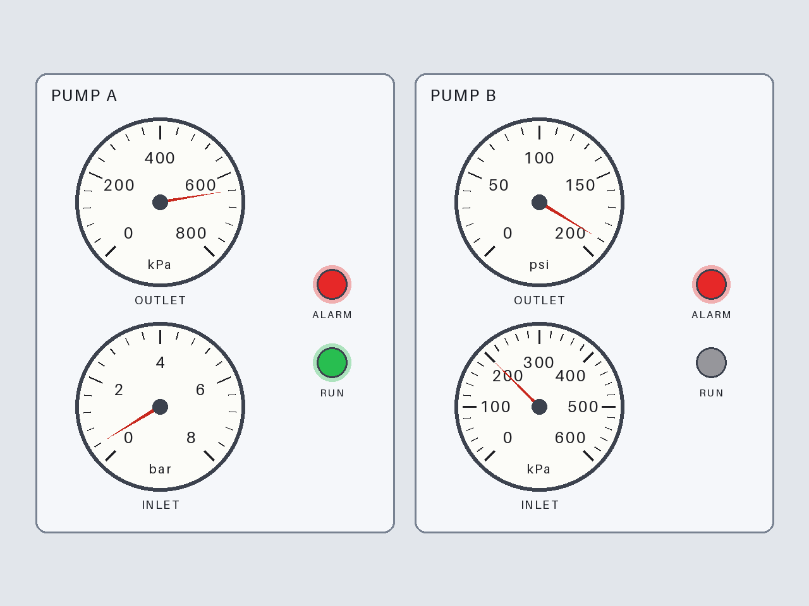

# PanelProof dataset card

The reference public build is v0.1.0. Its manifest is `a6d884a665c069da96facc90189922660a474f8cba9085a8af1a004b88fe2d00`. The v0.2 exporter validates same-question counterfactual pairs and distinguishes a public reproducibility build from a privately seeded holdout. [Public build report](results/dataset_report.json) · [Current holdout workflow](reproducibility.md#build-a-private-evaluation-holdout)

## Historical public build

| Item | Count |
| --- | --- |
| Accepted base groups | 110 (from 120 attempts) |
| Distinct scenes | 278 |
| Accepted answerable tasks | 783 |
| Diagnostic (missing-evidence) tasks | 40 |
| Variant pairs | 168 |
| Skill mix (answerable) | R 100, C 80, M 339, X 264 |

Pair members by variant: semantic 216, preserving 48, nuisance 72.

The task targets in `configs/benchmark.yaml` (R 100, C 80, M 150, X 100, pairs 50, diagnostics 40) were all met; M and X exceed their targets.

### Historical splits

Splits are by group, so a base scene and all of its siblings stay together: dev 22 groups, frozen main 68, frozen held-out style (theme `teal`) 20. No seed, group or image appears in two splits (audited).

### Historical balance

- State answers: `LOW_PRESSURE` 108, `NORMAL` 99, `STOPPED` 84.
- Consistency answers: `CONSISTENT` 133, `CONTRADICTION` 131.
- Layout families (panels): `1p-single` 375, `2p-rows` 408.
- Themes: sand 238, daylight 204, slate 186, teal 155.

## Expanded public reproducibility build

The [v0.3 expanded configuration](../configs/benchmark-expanded.yaml) adds `2p-cols`. It places two labeled pump modules side by side and stacks the two dials within each module. The design changes which instruments a reader must associate spatially. The existing independent verifier checks all three layouts.

The audited public build accepted **688 answerable tasks**, **285 valid question pairs**, and **40 separate diagnostic tasks**. It includes 347 single-pump, 160 two-pump row, and 181 two-pump column tasks. All three layouts occur in both development and frozen-style groups of this public reproducibility build. The audit found zero cross-split groups, images, and seeds. In the recorded build environment, a second build reproduced manifest SHA-256 `a8f51620ddfbfd13033e22804eae1be87cb043ead1db82cd08b44f0fc89c6d6a`. The digest covers encoded PNG bytes. [Rebuild and compare decoded pixels](reproducibility.md#artifact-hashes-and-decoded-pixels)

The v0.3 balanced X counts were 12 Dev (3 per cell), 80 frozen main, and 72 frozen held-out style. Report subgroup intervals alongside the number of base groups. Treat the small Dev slice as exploratory even if a bootstrap interval happens to be narrow.

## Current private holdout

The [v0.4 configuration](../configs/benchmark-dual-rule.yaml) uses all three layouts and adds operating-state tasks based on an inlet-pressure floor. The audit recorded **1,002** answerable tasks, **803** of them frozen, and **40** separate diagnostics. It checked **437** valid pairs. The new rule accounts for **300** tasks and **91** semantic pairs across all three layouts, including **102** inlet tasks in the column layout. Of those semantic pairs, **57** are targeted inlet-only crossings that preserve the pressure-difference classification.

| Split | Answerable | Inlet-floor tasks | Available X | Balanced X |
| --- | ---: | ---: | ---: | ---: |
| Dev | 199 | 61 | 46 | 32 |
| Frozen main | 559 | 166 | 135 | 120 |
| Frozen held-out style | 244 | 73 | 62 | 32 |

The default [measured preparation](../evals/conditions.md#measured-runs-need-a-freeze) selected **758** frozen tasks, including **239** inlet-floor tasks and **152** balanced X tasks. The v0.4 holdout and its selection have their own commitments. Use the pinned v0.4 cohort for runs intended to evaluate both rules and all three layouts. [Private build instructions](reproducibility.md#build-a-private-evaluation-holdout)

## v0.2 reference holdout

The audited v0.2 rebuild contains 696 answerable tasks, including 545 frozen tasks, 40 separate diagnostic tasks, and 282 valid question pairs across Dev and frozen splits. The answerable skill counts are R 100, C 80, M 269 and X 247. The audit found no overlap in group, image, or seed across splits. The rebuild preserved the original public files and all earlier private commitments.

| Split | Available X | Balanced X | Tasks in each cell | Complete X pairs | ALARM cue shift before → after |
| --- | ---: | ---: | ---: | ---: | ---: |
| Dev | 51 | 36 | 9 | 19 | 25.0 → 0.0 percentage points |
| Frozen main | 144 | 112 | 28 | 63 | 15.151 → 0.0 percentage points |
| Frozen held-out style | 52 | 40 | 10 | 21 | 3.846 → 0.0 percentage points |

Each current build writes `private/x_balanced_selection.json` and records its SHA-256 in the manifest's private commitments. The `task_ids` arrays identify the largest available equal-cell cohorts for `dev`, `frozen_main`, and `frozen_heldout_style` independently. The four cells cross the expected ALARM state from the rule with the ALARM state displayed on the panel. Every connected counterfactual component is selected as a whole or left out as a whole.

The selector uses the validated task truth and pair metadata before evaluation. It keeps the full dataset, task IDs, pair records, and separate missing-evidence diagnostic split intact. Use the selected IDs for the balanced slice and identify the slice in the evaluation report. Each split reports available and selected cell counts, complete pair counts, and the maximum shift in correct-answer proportions between the displayed ALARM states. A nonempty selection has exactly 0 percentage points of this marginal shift. `missing_cell` and `infeasible_with_pairs` mean that no nonempty exact selection was possible.

Run the usual `build-dataset` command for a reproducibility set or supply `--holdout-seed-file` for a measured holdout. Then run `audit-dataset --dataset <output>` to reproduce the selection from the local private index and check its commitment. Audit summaries show aggregate counts locally. Keep this selection artifact, per-task answers, and the measured seed in the private bundle.

The default [measured preparation](../evals/conditions.md#measured-runs-need-a-freeze) selected **501** frozen tasks on v0.2, including the complete **152** balanced X tasks. Selecting the full X scope separately yielded **545** tasks with **196** X tasks. This scope remains available for shortcut analysis and is labeled in the measured report. The original dataset and pairs remain available at their existing IDs.

## Provenance and license

Every image is generated by this repository's renderer. See [dataset sources](dataset_sources.md) and [third-party notices](../THIRD_PARTY_NOTICES.md). The repository code uses the existing [MIT license](../LICENSE). Licensing terms for a separate generated dataset release are pending a team decision.

## Privacy and safety

All content is fictional. Public files contain no per-task answers, seeds or evidence boxes. Frozen answers stay under `private/`. The token-protected reveal route is for authorized development tasks and samples.

## Limitations

- The v0.4 holdout covers three layouts, two operating-state rules, and four themes. Real photographs are outside the evaluated scope.
- The historical unbalanced X set had an ALARM-lamp cue shift of up to 28 percentage points. The full current set and its balanced slice have separate audit figures. The balanced slice controls the marginal ALARM cue only. [Validation results](validation.md)
- C tasks request the outlet pressure only.
- Zero human reviewers; the 50-task worksheet is unreviewed.
- Verifier acceptance is brittle under rotation, scaling, noise and compression (see [`validation.md`](validation.md)).
- The dev sample committed in `data/demo` and `data/samples` is public; the frozen set must not be published with its answers.
